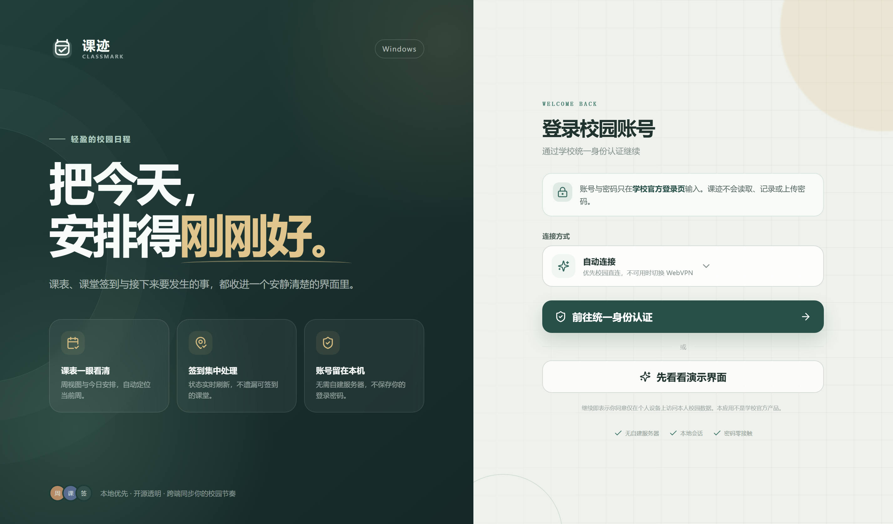
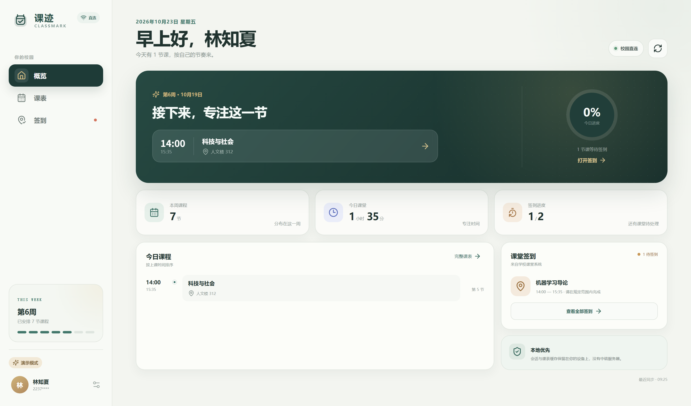

# 课迹 Classmark

课迹是一款面向校园课表与课堂签到的跨端客户端。它把本周课程、今日安排和签到状态整理在一个清楚、安静的界面里，同时**不依赖项目方自建服务器**。

支持 Windows 桌面端与 Android 端，业务逻辑和界面代码共享。

> 课迹是学生个人开发的开源客户端，不是学校官方产品。校园接口可能随学校系统升级而变化。





## 功能

- **统一认证登录**：在内置浏览器中打开学校官方认证页，密码不经过课迹。
- **课表总览**：展示当前学期、周次、今日课程和下一节课。
- **周课表**：切换学期与周次，桌面端显示时间网格，手机端显示按天列表。
- **课堂签到**：查看当天签到状态，并在学校允许的时间和范围内提交本人签到。
- **本科生与研究生**：自动适配本科教务课表，并在不可用时回退到研究生课表。
- **直连与 WebVPN**：校内可直接连接；校外可使用学校 WebVPN，无需项目服务器。
- **本地快照**：保存最近一次成功同步的课表，便于查阅。
- **响应式设计**：Windows 与 Android 使用同一套视觉与业务规则。

## 为什么没有服务器

课迹直接使用设备上的原生网络会话访问学校服务：

- Windows：Electron 主进程在受限地址白名单内完成请求。
- Android：原生插件与 WebView 共享 Cookie，并由系统网络栈发起请求。
- 应用只在本机保存会话 Cookie、显示名称和课表快照。
- 应用不会读取或保存统一认证页中输入的密码。

详细说明见 [隐私与安全](docs/privacy.md) 和 [架构说明](docs/architecture.md)。

## 本地开发

环境要求：

- Node.js 22.12 或更高版本
- Windows 桌面打包：Windows 10/11
- Android 打包：JDK 21、Android SDK 35

```bash
npm install
npm run dev:desktop
```

仅预览 Web 界面：

```bash
npm run dev
```

浏览器预览不能访问原生 Cookie 和校园网络，请点击“先看看演示界面”。真实登录需要在 Windows 或 Android 客户端中进行。

## 测试

```bash
npm run typecheck
npm test
npm run build:web
```

## 构建

### Windows

```bash
npm run build:desktop
```

安装包输出到 `release/`。

### Android

```bash
npm run build:android
```

调试 APK 输出到：

```text
android/app/build/outputs/apk/debug/app-debug.apk
```

正式发布前请配置自己的 Android 签名密钥，不要提交 `.jks`、密码或签名配置。

## 项目结构

```text
src/                 React 界面与校园业务逻辑
electron/            Windows 主进程、预加载桥接与认证窗口
android/             Capacitor Android 原生工程
tests/               解析、日期与 WebVPN 单元测试
docs/                架构、隐私与发布文档
.github/             CI、Release 与社区协作模板
```

## 使用边界

课迹只帮助用户访问本人的课表与签到信息。它不提供代签、虚拟定位、绕过校园系统校验或批量控制他人账号的能力。请遵守学校信息系统使用规定。

## 许可证

[MIT License](LICENSE)

Copyright © 2026 Huiteng Zhuang

第三方依赖的许可见 [THIRD_PARTY_NOTICES.md](THIRD_PARTY_NOTICES.md)。
